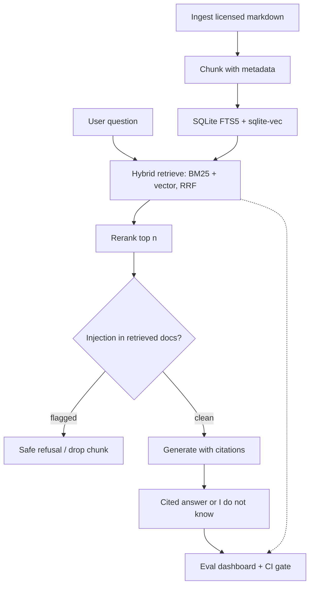

# audit-rag-assistant

[](https://github.com/Anondevnet/audit-rag-assistant/actions/workflows/ci.yml)

**Work in progress — Milestone 1 of 3.** This repo currently ships a license-cleared corpus, a hybrid retriever, and tests. It does **not** yet generate answers, score a golden set, or host a public demo. There are **no metrics** to report.

A cited RAG assistant over educational smart-contract weakness write-ups. You ask a question; the CLI returns the top-k chunks with stable citation markers, licenses, and source URLs. Later milestones add generation with forced citations, prompt-injection guards on retrieved documents, an eval dashboard, and a free-tier deploy.

This is not a substitute for a professional audit, and the corpus is not a collection of firm audit reports.

## Demo

A 30-second demo GIF will be added in Milestone 2, after generation and the dashboard exist.

## Results

Intentionally blank. Baseline-vs-improved Recall@k, MRR, citation accuracy, faithfulness, latency, and cost/query will be filled from `eval/reports/latest.json` only after the Milestone 2 harness has been run on a human-reviewed golden set. Do not invent numbers.

## Architecture (target)

Milestone 1 implements ingest → chunk → index → hybrid retrieve → rerank. Generation, guardrails, and the eval dashboard are Milestone 2.



## Dataset

49 documents, all attributed:

- 37 entries from the [SWC Registry](https://github.com/SmartContractSecurity/SWC-registry) (MIT)
- 12 category write-ups from [not-so-smart-contracts](https://github.com/crytic/not-so-smart-contracts) (Apache-2.0)

**Not included:** Code4rena, Sherlock, or Solodit content. See [DATA.md](DATA.md) for licenses, pinned commits, and the reasons those sources were excluded.

## Quickstart

Requires Python 3.11+.

```bash
python3.11 -m venv .venv
source .venv/bin/activate
pip install -e ".[dev]"

# Offline, deterministic embeddings (same path CI uses):
export AUDIT_RAG_EMBEDDER=hashing
export AUDIT_RAG_RERANKER=token

python -m audit_rag ingest
python -m audit_rag search "How do I prevent a reentrancy attack?"
```

To use local Ollama embeddings instead (not required, not used in CI):

```bash
ollama pull nomic-embed-text
export AUDIT_RAG_EMBEDDER=ollama
python -m audit_rag ingest
python -m audit_rag search "How do I prevent a reentrancy attack?"
```

The embedder used at search time must match the one used at ingest. Optional FlashRank reranking: `pip install -e ".[local]"` and `export AUDIT_RAG_RERANKER=flashrank` (downloads a small ONNX model on first use).

## Tests

```bash
AUDIT_RAG_EMBEDDER=hashing AUDIT_RAG_RERANKER=token pytest
```

## Eval

Twenty seed questions live in [`evals/golden_seed.jsonl`](evals/golden_seed.jsonl). Every row is marked `status: needs_human_review`. Do not treat the proposed answers as ground truth until they have been checked.

## Limitations (Milestone 1)

- Retrieval only: no answer generation, no injection guards, no dashboard.
- The hashing embedder is for offline tests; it is not a semantic model.
- SWC content is educational and no longer actively maintained upstream (2020).
- No live demo URL yet.

Code is MIT (Copyright 2026 Anondevnet). Third-party corpus text stays under its original MIT / Apache-2.0 licenses; see [NOTICE](NOTICE) and [DATA.md](DATA.md).
