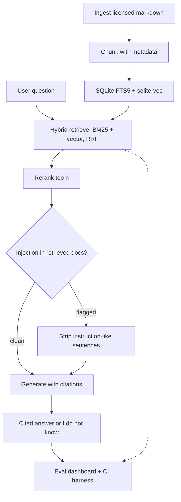

# audit-rag-assistant

[](https://github.com/Anondevnet/audit-rag-assistant/actions/workflows/ci.yml)

**Milestone 3 work in progress.** License-cleared corpus, improved hybrid retrieval, cited extractive answers, prompt-injection guards, an eval dashboard, and a deployable FastAPI demo. A public URL is added only when a free-tier host is already authenticated.

A cited RAG assistant over educational smart-contract weakness write-ups. You ask a question; the CLI retrieves chunks, treats them as untrusted data, and either quotes cited sentences or refuses when the evidence is insufficient.

This is not a substitute for a professional audit, and the corpus is not a collection of firm audit reports.

## Demo


Regenerate locally with `python scripts/record_demo.py` after `audit-rag ingest` (requires ffmpeg; optional Pillow).

## Results

**Before** is the Milestone 2 CI baseline in [`evals/reports/m2-baseline.json`](evals/reports/m2-baseline.json) (`dce5300`, hashing + token rerank + extractive, 468 chunks).

**After** is [`evals/reports/latest.json`](evals/reports/latest.json) / [`evals/reports/hashing-token.json`](evals/reports/hashing-token.json): the same hashing + token + extractive CI stack, after (1) merging short heading-only sections so 5-token title stubs no longer dominate BM25, (2) query expansion (SWC title lookup, hyphen variants, a small synonym list — not gold-answer look-up), and (3) a length-floored token reranker with a mild section prior. The corpus now has **345** chunks. Golden `chunk_id`s were rematched to the passages that still contain the same source key points (description/remediation/mitigation), not by picking whatever the retriever returned.

Static dashboard: [`evals/reports/dashboard.html`](evals/reports/dashboard.html).

| Metric | Before (M2) | After (hashing + token) |
| --- | ---: | ---: |
| Recall@5 (all gold chunks) | 0.1667 | **0.6667** |
| Mean recall@5 | 0.4231 | **0.8426** |
| MRR@5 | 0.5130 | **0.7176** |
| Doc recall@5 | 1.0000 | **1.0000** |
| Recall@10 (all gold chunks) | 0.4444 | **0.7778** |
| Mean recall@10 | 0.7324 | **0.9306** |
| MRR@10 | 0.5464 | **0.7269** |
| Doc recall@10 | 1.0000 | **1.0000** |
| Citation accuracy | 1.0000 | **1.0000** |
| Faithfulness (lexical) | 1.0000 | **1.0000** |
| Refusal accuracy | 1.0000 | **1.0000** |
| Harness time (20 questions) | 76.3 ms | 94.4 ms |
| Cost / query | $0 | $0 |

Other labeled runs, same gold set and extractive generator (not the CI default):

| Config | Recall@5 all | Mean R@5 | MRR@5 | Recall@10 all | Mean R@10 | MRR@10 | Refusal | Harness time |
| --- | ---: | ---: | ---: | ---: | ---: | ---: | ---: | ---: |
| hashing + no rerank | 0.1667 | 0.3472 | 0.3806 | 0.5556 | 0.7639 | 0.4251 | 1.0000 | 82.6 ms |
| hashing + token (default) | 0.6667 | 0.8426 | 0.7176 | 0.7778 | 0.9306 | 0.7269 | 1.0000 | 94.4 ms |
| hashing + FlashRank MiniLM-L-12 | 0.5000 | 0.7176 | 0.7009 | 0.6111 | 0.8148 | 0.7065 | 0.9500 | 56.6 s |
| Ollama nomic-embed-text + no rerank | 0.6111 | 0.7778 | 0.6991 | 0.7222 | 0.8750 | 0.7083 | 1.0000 | 459.8 ms |
| Ollama nomic-embed-text + token | 0.6111 | 0.8148 | 0.7148 | 0.7778 | 0.9306 | 0.7218 | 1.0000 | 335.9 ms |
| Ollama nomic-embed-text + FlashRank | 0.5000 | 0.7176 | 0.6685 | 0.6111 | 0.8009 | 0.6741 | 1.0000 | 48.9 s |

The FlashRank MiniLM-L-12 cross-encoder (21.6 MB, already-installed `onnxruntime`) did **not** beat the token reranker on this 20-question set, and the hashing+FlashRank run had one false refusal (q01). Local `nomic-embed-text` also did not beat hashing+token here. The default therefore stays the CI-friendly hashing + token stack. No gold answers were hard-coded into retrieval.

### How the metrics are computed

These are lexical, deterministic methods, not an LLM-as-judge. They will miss some valid paraphrases and can look strong when the generator copies sentences from cited chunks (as the extractive fallback does).

- **Recall@k (all gold):** fraction of answerable questions where *every* gold `chunk_id` appears in the top-k retrieved chunks.
- **Mean recall@k:** macro-average of `|gold ∩ retrieved@k| / |gold|` on answerable questions.
- **MRR@k:** mean reciprocal rank of the first gold chunk in the retrieved list, on answerable questions.
- **Doc recall@k:** fraction of answerable questions where at least one gold `doc_id` appears in the top k.
- **Citation accuracy:** on each non-refusal answer, every claim sentence must have a `[rank:chunk_id]` marker, the chunk must be in the retrieved set, and at least half of the claim's content tokens (minimum 3, or all if fewer) must appear in the cited chunk. Refusals with no citation markers score 1.0.
- **Faithfulness:** the same lexical support test as citation accuracy. It is not a semantic entailment score.
- **Refusal accuracy:** `(true refusals + true answers) / N`, using `must_refuse` from the golden set. q19 (Code4rena / Uniswap contest findings) and q20 (a Trail of Bits client-audit dollar-loss figure) must refuse because that material is not in the corpus.

The extractive generator also refuses when a proper-noun or identifier token from the question is missing from the retrieved chunks, or when a question asks for an exact dollar/amount loss and the candidate answer has no currency figure.

## Architecture

Milestone 2 implements ingest → chunk → index → hybrid retrieve → rerank → injection guards → cited generate or refuse → eval dashboard.



## Dataset

49 documents, all attributed:

- 37 entries from the [SWC Registry](https://github.com/SmartContractSecurity/SWC-registry) (MIT)
- 12 category write-ups from [not-so-smart-contracts](https://github.com/crytic/not-so-smart-contracts) (Apache-2.0)

**Not included:** Code4rena, Sherlock, or Solodit content. See [DATA.md](DATA.md) for licenses, pinned commits, and the reasons those sources were excluded.

## Quickstart

Requires Python 3.11+.

```bash
python3.11 -m venv .venv
source .venv/bin/activate
pip install -e ".[dev]"

# Offline, deterministic path (same as CI):
export AUDIT_RAG_EMBEDDER=hashing
export AUDIT_RAG_RERANKER=token
export AUDIT_RAG_GENERATOR=extractive

python -m audit_rag ingest
python -m audit_rag search "How do I prevent a reentrancy attack?"
python -m audit_rag ask "Why is authorization through tx.origin considered unsafe?"
python -m audit_rag ask "What high-severity findings were reported in a 2024 Uniswap audit contest on Code4rena?"
python scripts/eval.py --k 10
```

Open `evals/reports/dashboard.html` for the metric cards and per-question table.

To use local Ollama embeddings instead (not required, not used in CI):

```bash
ollama pull nomic-embed-text
export AUDIT_RAG_EMBEDDER=ollama
python -m audit_rag ingest
```

Optional chat generation, only when you set a model yourself (the repo does not pick a default chat model):

```bash
export AUDIT_RAG_GENERATOR=ollama
export OLLAMA_CHAT_MODEL=your-local-model
python -m audit_rag ask "Why is authorization through tx.origin considered unsafe?"
```

The embedder used at search time must match the one used at ingest. Optional FlashRank reranking: `pip install -e ".[local]"` and `export AUDIT_RAG_RERANKER=flashrank` (downloads a small ONNX model on first use).

## Tests

```bash
AUDIT_RAG_EMBEDDER=hashing AUDIT_RAG_RERANKER=token AUDIT_RAG_GENERATOR=extractive pytest
```

CI also runs a smoke ingest/search/ask and `python scripts/eval.py --k 10`. The harness step checks that eval runs; it does not fail the build on metric drift.

## Eval and injection set

Twenty approved seed questions live in [`evals/golden_seed.jsonl`](evals/golden_seed.jsonl). Thin items q06, q12, q16, q17, and q18 were filled from exact wording in the source documents. Prompt-injection fixtures are in [`evals/injection/`](evals/injection/) and are covered by `tests/test_injection.py` and `tests/test_guardrails.py`.

## Deploy

A FastAPI demo lives in `src/audit_rag/web.py` (`GET /`, `POST /api/ask`, `GET /health`, `GET /dashboard`). The image is sized for a Render **free** web service (0.1 CPU, 512 MB) or Fly's low-tier machines: hashing embeddings, token rerank, extractive answers, index built at image-build time.

```bash
pip install -e ".[web]"
export AUDIT_RAG_EMBEDDER=hashing AUDIT_RAG_RERANKER=token AUDIT_RAG_GENERATOR=extractive
python -m audit_rag ingest
uvicorn audit_rag.web:app --host 0.0.0.0 --port 8000
```

Blueprint: [`render.yaml`](render.yaml). Alternative: [`fly.toml`](fly.toml) + [`Dockerfile`](Dockerfile). A public deploy is only applied when a Render or Fly CLI is already authenticated; this repo does not create paid services.

## Limitations

- The hashing embedder is an offline, non-semantic model. On this gold set, after the ranking and chunking changes, it outperformed local `nomic-embed-text` and FlashRank, so it remains the default.
- The committed metrics use the extractive generator. Citation accuracy and faithfulness are lexical overlap tests and will naturally be high for extractive copies.
- Because short heading chunks were merged, before/after recall is a system-level comparison (468 vs 345 chunks, rematched gold IDs to the same source key points), not a frozen-ID ablation of the reranker alone.
- SWC content is educational and no longer actively maintained upstream (2020).
- No public demo URL is claimed until a free-tier host is actually authenticated and verified.

Code is MIT (Copyright 2026 Anondevnet). Third-party corpus text stays under its original MIT / Apache-2.0 licenses; see [NOTICE](NOTICE) and [DATA.md](DATA.md).
