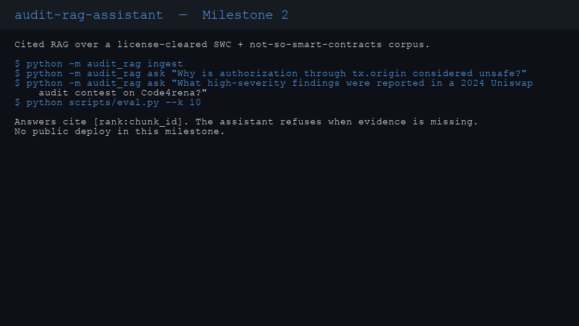
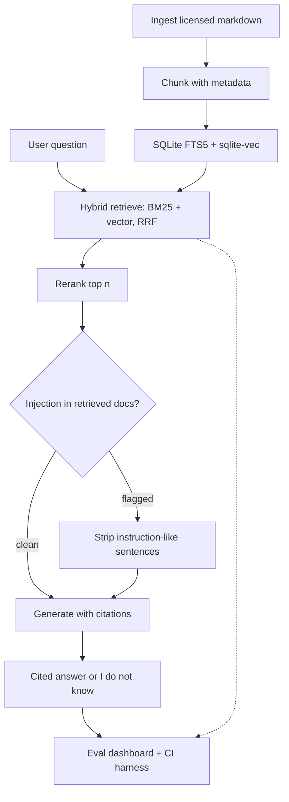

# audit-rag-assistant

[](https://github.com/Anondevnet/audit-rag-assistant/actions/workflows/ci.yml)

**Milestone 2 of 3.** License-cleared corpus, hybrid retrieval, cited extractive answers, prompt-injection guards, a golden-set eval harness, and a static dashboard. There is **no public deploy** in this milestone.

A cited RAG assistant over educational smart-contract weakness write-ups. You ask a question; the CLI retrieves chunks, treats them as untrusted data, and either quotes cited sentences or refuses when the evidence is insufficient.

This is not a substitute for a professional audit, and the corpus is not a collection of firm audit reports.

## Demo



Regenerate locally with `python scripts/record_demo.py` after `audit-rag ingest` (requires ffmpeg; optional Pillow).

## Results

Numbers below are from [`evals/reports/latest.json`](evals/reports/latest.json), produced by `python scripts/eval.py --k 10` with the CI-reproducible stack:

- embedder: `hashing` (deterministic offline fallback, not a semantic model)
- reranker: `token`
- generator: `extractive`
- golden set: 20 owner-approved questions (`evals/golden_seed.jsonl`); 18 answerable, 2 must-refuse (q19, q20)
- corpus: 49 documents, 468 chunks

Static dashboard: [`evals/reports/dashboard.html`](evals/reports/dashboard.html).

| Metric | Value |
| --- | ---: |
| Recall@5 (all gold chunks) | 0.1667 |
| Mean recall@5 | 0.4231 |
| MRR@5 | 0.5130 |
| Doc recall@5 | 1.0000 |
| Recall@10 (all gold chunks) | 0.4444 |
| Mean recall@10 | 0.7324 |
| MRR@10 | 0.5464 |
| Doc recall@10 | 1.0000 |
| Citation accuracy | 1.0000 |
| Faithfulness (lexical) | 1.0000 |
| Refusal accuracy | 1.0000 |
| Refusal breakdown | 2 true refuse, 18 true answer, 0 false refuse, 0 false answer |
| Harness time (20 questions) | 76.3 ms |
| Mean retrieve / generate | 2.05 ms / 1.62 ms |
| Cost / query | $0 (local, no API) |

### How the metrics are computed

These are lexical, deterministic methods, not an LLM-as-judge. They will miss some valid paraphrases and can look strong when the generator copies sentences from cited chunks (as the extractive fallback does).

- **Recall@k (all gold):** fraction of answerable questions where *every* gold `chunk_id` appears in the top-k retrieved chunks.
- **Mean recall@k:** macro-average of `|gold ∩ retrieved@k| / |gold|` on answerable questions.
- **MRR@k:** mean reciprocal rank of the first gold chunk in the retrieved list, on answerable questions.
- **Doc recall@k:** fraction of answerable questions where at least one gold `doc_id` appears in the top k.
- **Citation accuracy:** on each non-refusal answer, every claim sentence must have a `[rank:chunk_id]` marker, the chunk must be in the retrieved set, and at least half of the claim's content tokens (minimum 3, or all if fewer) must appear in the cited chunk. Refusals with no citation markers score 1.0.
- **Faithfulness:** the same lexical support test as citation accuracy. It is not a semantic entailment score.
- **Refusal accuracy:** `(true refusals + true answers) / N`, using `must_refuse` from the golden set. q19 (Code4rena / Uniswap contest findings) and q20 (a Trail of Bits client-audit dollar-loss figure) must refuse because that material is not in the corpus.

The extractive generator also refuses when a proper-noun or identifier token from the question is missing from the retrieved chunks, or when a question asks for an exact dollar/amount loss and the candidate answer has no currency figure.

Recall@5 (all gold) is low under the hashing embedder because several gold items list 3–5 chunks and the hashing vectors are not semantic. Doc recall@10 is 1.0: the right document still reaches the top 10 even when not every gold chunk does. Unique lexical queries (for example `tx.origin`) retrieve well; paraphrases such as "how do I prevent a reentrancy attack?" often surface related but off-target chunks.

A second, labeled run with local Ollama `nomic-embed-text` embeddings, the same token reranker, and the same extractive generator is in [`evals/reports/ollama-nomic.json`](evals/reports/ollama-nomic.json). Those numbers are **not** the CI baseline. On this 20-question set they did not beat hashing: recall@5 (all gold) stayed 0.1667, mean recall@10 was 0.7074 vs 0.7324, and MRR@10 was 0.5386 vs 0.5464. Refusal, citation accuracy, and faithfulness remained 1.0000. The first attempt to embed all 468 chunks in one Ollama request returned HTTP 400; the embedder now batches (default 8).

## Architecture

Milestone 2 implements ingest → chunk → index → hybrid retrieve → rerank → injection guards → cited generate or refuse → eval dashboard.



## Dataset

49 documents, all attributed:

- 37 entries from the [SWC Registry](https://github.com/SmartContractSecurity/SWC-registry) (MIT)
- 12 category write-ups from [not-so-smart-contracts](https://github.com/crytic/not-so-smart-contracts) (Apache-2.0)

**Not included:** Code4rena, Sherlock, or Solodit content. See [DATA.md](DATA.md) for licenses, pinned commits, and the reasons those sources were excluded.

## Quickstart

Requires Python 3.11+.

```bash
python3.11 -m venv .venv
source .venv/bin/activate
pip install -e ".[dev]"

# Offline, deterministic path (same as CI):
export AUDIT_RAG_EMBEDDER=hashing
export AUDIT_RAG_RERANKER=token
export AUDIT_RAG_GENERATOR=extractive

python -m audit_rag ingest
python -m audit_rag search "How do I prevent a reentrancy attack?"
python -m audit_rag ask "Why is authorization through tx.origin considered unsafe?"
python -m audit_rag ask "What high-severity findings were reported in a 2024 Uniswap audit contest on Code4rena?"
python scripts/eval.py --k 10
```

Open `evals/reports/dashboard.html` for the metric cards and per-question table.

To use local Ollama embeddings instead (not required, not used in CI):

```bash
ollama pull nomic-embed-text
export AUDIT_RAG_EMBEDDER=ollama
python -m audit_rag ingest
```

Optional chat generation, only when you set a model yourself (the repo does not pick a default chat model):

```bash
export AUDIT_RAG_GENERATOR=ollama
export OLLAMA_CHAT_MODEL=your-local-model
python -m audit_rag ask "Why is authorization through tx.origin considered unsafe?"
```

The embedder used at search time must match the one used at ingest. Optional FlashRank reranking: `pip install -e ".[local]"` and `export AUDIT_RAG_RERANKER=flashrank` (downloads a small ONNX model on first use).

## Tests

```bash
AUDIT_RAG_EMBEDDER=hashing AUDIT_RAG_RERANKER=token AUDIT_RAG_GENERATOR=extractive pytest
```

CI also runs a smoke ingest/search/ask and `python scripts/eval.py --k 10`. The harness step checks that eval runs; it does not fail the build on metric drift.

## Eval and injection set

Twenty approved seed questions live in [`evals/golden_seed.jsonl`](evals/golden_seed.jsonl). Thin items q06, q12, q16, q17, and q18 were filled from exact wording in the source documents. Prompt-injection fixtures are in [`evals/injection/`](evals/injection/) and are covered by `tests/test_injection.py` and `tests/test_guardrails.py`.

## Limitations (Milestone 2)

- The hashing embedder is an offline test fallback, not a semantic model; chunk-level recall is modest on paraphrased questions.
- The committed metrics use the extractive generator. Citation accuracy and faithfulness are lexical overlap tests and will naturally be high for extractive copies.
- SWC content is educational and no longer actively maintained upstream (2020).
- No live demo URL yet. Deploy is deferred until it is requested.

Code is MIT (Copyright 2026 Anondevnet). Third-party corpus text stays under its original MIT / Apache-2.0 licenses; see [NOTICE](NOTICE) and [DATA.md](DATA.md).
